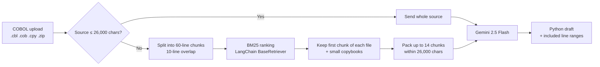

# legacy-agent ⚡

> **Turn legacy COBOL into a reviewable Python draft using Gemini and local BM25 code retrieval.**

[-emerald)](#case-study-cms-medicare-hospice-pricer)
[-cyan)](#case-study-cms-medicare-hospice-pricer)
[](#quickstart)
[](#license)

Ten days of Dallas hospice care should cost **$1,911**. One typo made Medicare's code pay **$134,248**, with no error. legacy-agent helps you read, convert, and test code like that.

---

## Contents

- [Why this exists](#why-this-exists)
- [What it does](#what-it-does)
- [How it works](#how-it-works)
- [How BM25 retrieval works](#how-bm25-retrieval-works)
- [Case study: CMS Medicare Hospice Pricer](#case-study-cms-medicare-hospice-pricer)
- [Quickstart](#quickstart)
- [Configuration](#configuration)
- [API](#api)
- [Project structure](#project-structure)
- [Limitations](#limitations)
- [License](#license)

---

## Why this exists

COBOL was designed in 1959 for business record-keeping. Banks, insurers, and government agencies built their core systems on it, and many of those systems still run today.

COBOL isn't broken. The trouble is that these programs are large, old, and understood by fewer people every year:

- Business rules are spread across thousands of lines and shared copybooks.
- Records are fixed-width, so every field depends on its exact character position.
- Small details, like where an intermediate value gets truncated, change the final dollar amount.

That makes every change slow and risky.

---

## What it does

| Feature | What you get |
|---|---|
| **Upload and convert** | Drop in `.cbl`, `.cob`, `.cpy`, or a `.zip` of them. Gemini drafts idiomatic Python 3 that uses `Decimal` for money. |
| **Local retrieval for large sources** | Large programs are chunked and ranked with a local BM25 retriever, so Gemini gets the most relevant code without an embeddings API. |
| **Traceable output** | Each result lists the exact file and line ranges sent to the model, so you can see what was left out. |
| **Built-in demo** | Load the real CMS FY2020 hospice pricer source with one click. |
| **Runnable case study** | The real CMS FY2020 hospice pricer COBOL, buildable with GnuCOBOL, plus a typed Python rewrite shown in the app. |

> [!IMPORTANT]
> Generated code is a **draft**. The app doesn't run or parity-test conversions of arbitrary uploads. Review and test the output before relying on it.

---

## How it works



1. **The browser** reads uploaded files (unzipping archives with JSZip) and posts the combined source to the local API.
2. **The Node API** ([server/index.mjs](server/index.mjs)) builds a context pool: either the whole source, or a BM25-selected subset.
3. **Gemini** turns that context into Python. The prompt treats the COBOL as untrusted data and asks the model to flag any assumptions it can't resolve.
4. **The UI** shows the Python draft next to the line ranges that were included.

The Gemini API key stays on the server and is never sent to the browser.

---

## How BM25 retrieval works

### The problem it solves

A real COBOL system can run to hundreds of thousands of characters. Sending all of it to an LLM is slow and expensive, and can exceed the context window. Large prompts also dilute the model's attention: the arithmetic that actually decides a payment gets buried under boilerplate. We need to pick the parts that matter.

### What BM25 is

**BM25** (Best Match 25) is a classic keyword ranking algorithm, the same family of scoring used by search engines like Elasticsearch and Lucene. It scores each chunk of text against a query using three ideas:

| Idea | Meaning | Effect in COBOL |
|---|---|---|
| **Term frequency** | A chunk that mentions a query term more often scores higher, with diminishing returns (`k1 = 1.5`). | A paragraph full of `COMPUTE` and `MULTIPLY` outranks one with a single `MOVE`. |
| **Inverse document frequency** | Rare terms count more than common ones. | `COMP-3` or `REDEFINES` in one chunk is a strong signal; `MOVE`, which is everywhere, barely counts. |
| **Length normalization** | Long chunks don't win just for being long (`b = 0.75`). | A 60-line comment banner doesn't beat a dense 20-line calculation. |

### Why BM25 fits COBOL better than embeddings

Most RAG pipelines use vector embeddings. For COBOL, keyword search is often the better tool:

- **COBOL is keyword-heavy.** Verbs like `COMPUTE`, `EVALUATE`, and `PERFORM` and clauses like `PIC` and `OCCURS` mark exactly where business logic and data layouts live. Exact keyword matching finds them reliably.
- **Identifiers are exact.** A name like `HR-BILL-PAY-AMT1` should match exactly. Embedding models trained mostly on modern prose can blur these together.
- **No extra API call or cost.** BM25 runs in a few milliseconds in Node, needs no vector database, and sends nothing to a third party just to build the index.
- **Results are explainable.** You can see why a chunk ranked high: it contains these terms, this often.

### Where LangChain fits

The retriever extends LangChain's `BaseRetriever` from `@langchain/core`, and each chunk is a LangChain `Document` with metadata (`fileName`, `lineStart`, `lineEnd`). That gives us:

- **A standard interface.** `retriever.invoke(query)` behaves like any other LangChain retriever, so it can later be swapped for, or combined with, a vector retriever (for example in an `EnsembleRetriever`) without changing the calling code.
- **Metadata that carries through.** Line ranges travel with every chunk, which is how the UI can show exactly what was sent to Gemini.
- **Tracing hooks.** Retriever runs are tagged (`cobol`, `bm25`, `local-rag`) for LangChain callbacks and tracing tools.

### The pipeline in this app

1. **Tokenize.** Source is uppercased and split into COBOL-style tokens, keeping hyphenated names whole (`WS-TOTAL-AMT` stays one token).
2. **Chunk.** Each file is cut into 60-line windows with 10 lines of overlap, so a statement that crosses a boundary appears whole in at least one chunk.
3. **Query.** A fixed query lists the COBOL divisions, sections, verbs, and data clauses that signal structure and business logic.
4. **Rank.** BM25 scores every chunk and keeps the top 14.
5. **Pin essentials.** The first chunk of every file (`PROGRAM-ID`, file setup) and every small copybook are always included, because Python can't be generated without the record layouts.
6. **Pack.** Chunks are added until the 26,000-character budget is full, then re-sorted into original file and line order so Gemini reads them top to bottom.

Retrieval can leave code out. That's why the result lists every included range and the prompt tells Gemini not to invent missing rules.

---

## Case study: CMS Medicare Hospice Pricer

The repository includes the real COBOL that Medicare used to price hospice claims in FY2020, taken from the CMS PC Pricer archive. You can compile it with GnuCOBOL and run claims through it. The app's results view shows a typed Python rewrite of the same pricing logic. See [legacy_data/hospice-legacy/README.md](legacy_data/hospice-legacy/README.md) for the full write-up.

> [!NOTE]
> The benchmark figures below apply only to this case study, not to code Gemini generates from arbitrary uploads.

### Before and after

A hospice patient in **Dallas, TX** (CBSA `19124`), admitted **Feb 1, 2020**, receives **10 days of routine home care** starting **March 1, 2020**.

**Before (COBOL):** pack a 315-character fixed-width mainframe record.

```text
00000000009999992020030120200201          1912419124009747009747000000000000000000        0651     20200301000001000000000 ...
```

**After (Python):** pass a typed JSON payload.

```json
{
  "patient_area": "19124",
  "admission_date": "2020-02-01",
  "service_date": "2020-03-01",
  "routine_home_days": 10
}
```

Both return **$1,911.19**: `(133.64 × 0.9747 + 60.86) × 10`.

### The silent $134,248 payment

If the Dallas wage index is mistyped as `99.9999` instead of `0.9747`, the original COBOL calculates a **$134,248.47** payment and returns code `75` (success). It never sanity-checks the rate. The Python rewrite looks the wage index up from the CBSA table and rejects the override.

### The 4-decimal rounding quirk

In early regression testing, **6 of 500 crisis-care claims** were off by exactly **one cent**. The cause:

- COBOL divides the daily continuous-care rate by 24 and **truncates the hourly rate to 4 decimal places** before multiplying by hours.
- A straightforward rewrite rounds at the end instead, and misses by a penny.
- The Python rewrite reproduces the truncation.

### Results

| Metric | Result |
|---|---|
| Benchmark claims matched to the penny | **2,000 / 2,000** |
| Lines of code | **5,842 COBOL → 173 Python** (97% smaller) |
| Bad claims caught that COBOL accepted | Wage-index overrides, unknown CBSA codes |

### Run the original COBOL pricer

`price.py` builds the 315-character bill record, calls the compiled CMS COBOL, and reads the result back. All payment math happens inside the original COBOL.

```bash
# One-time setup (macOS; on Ubuntu: sudo apt install gnucobol3)
brew install gnucobol
./legacy_data/hospice-legacy/build.sh

# Price one claim: 10 days of routine home care in Dallas
python3 legacy_data/hospice-legacy/price.py --cbsa 19124 --admit 2020-02-01 --from 2020-03-01 --rhc 10

# Price the 10 sample claims
python3 legacy_data/hospice-legacy/price.py --csv legacy_data/hospice-legacy/sample_claims.csv
```

Service dates must fall in FY2020 (2019-10-01 to 2020-09-30). More detail is in the [case study README](legacy_data/hospice-legacy/README.md#run-it-on-a-mac).

---

## Quickstart

Requires **Node.js 20+** and a [Gemini API key](https://aistudio.google.com/apikey).

```bash
git clone https://github.com/AKdaAKA/legacy-agent.git
cd legacy-agent
npm install

cp .env.example .env
# Edit .env and set GEMINI_API_KEY

npm run dev
```

Open **http://localhost:5173**, then either:

- upload `.cbl`, `.cob`, `.cpy`, or a `.zip` of them, or
- load the built-in hospice demo,

and select **Convert COBOL to Python with Gemini**.

### Production

```bash
npm start   # builds the frontend, then serves the app and API on port 3001
```

Open **http://localhost:3001**. In production, supply `GEMINI_API_KEY` through your host's secret manager, not a committed file. The frontend and API must share an origin, or sit behind a same-origin `/api` route.

---

## Configuration

| Variable | Default | Purpose |
|---|---|---|
| `GEMINI_API_KEY` | none (required) | Server-side Gemini key. Never exposed to Vite or the browser. |
| `GEMINI_MODEL` | `gemini-2.5-flash` | Gemini model used for conversion. |
| `PORT` | `3001` | Port for the API and production server. |

Retrieval settings are constants at the top of [server/index.mjs](server/index.mjs):

| Constant | Value | Meaning |
|---|---|---|
| `MAX_BODY_BYTES` | 32 MB | Largest accepted request body |
| `FULL_SOURCE_CONTEXT_CHARS` | 26,000 | Sources at or under this size are sent whole |
| `MAX_CONTEXT_CHARS` | 26,000 | Context budget when retrieval is used |
| `CHUNK_LINES` / `CHUNK_OVERLAP_LINES` | 60 / 10 | Chunk window and overlap |
| `MAX_RETRIEVED_CHUNKS` | 14 | Top BM25 results considered |

---

## API

### `POST /api/convert`

```json
{ "fileName": "HOSPR200.cbl", "source": "       IDENTIFICATION DIVISION. ..." }
```

Response:

```json
{
  "pythonCode": "from decimal import Decimal\n...",
  "contextPool": {
    "mode": "langchain-bm25",
    "sourceCharacters": 312540,
    "contextCharacters": 25811,
    "totalChunks": 118,
    "includedChunks": 12,
    "includedRanges": [{ "fileName": "HOSPR200.cbl", "lineStart": 1, "lineEnd": 60 }]
  }
}
```

`mode` is `full-source` when the whole program fits in the budget. Errors return `{ "error": "..." }` with status `400`, `413`, `502`, or `503`.

### `GET /api/demo-source`

Returns `{ "fileName": "HOSPR200.cbl", "source": "..." }` for the built-in demo.

---

## Project structure

```text
legacy-agent/
├── server/
│   └── index.mjs            # Node API: BM25 retrieval, Gemini calls, static hosting
├── src/
│   ├── App.tsx              # Main studio UI (home, upload, results)
│   ├── components/          # Inspectors, punch-card decoder, parity showdown
│   └── data/                # Demo scenarios and sample data
├── legacy_data/
│   └── hospice-legacy/      # CMS FY2020 hospice pricer case study
│       ├── src/             # Original CMS COBOL + GnuCOBOL driver (HOSRUN.cbl)
│       ├── build.sh         # Compiles the COBOL with GnuCOBOL
│       ├── price.py         # Runs claims through the compiled COBOL
│       └── sample_claims.csv
├── .env.example
└── package.json
```

---

## Limitations

- **Drafts, not proofs.** Conversions of uploaded code aren't run or parity-tested automatically.
- **Case-study benchmark isn't scripted yet.** The 2,000-claim comparison and the Python rewrite aren't committed as standalone, runnable files; the repo ships 10 sample claims and their COBOL results.
- **Retrieval can omit code.** For large sources, check the included line ranges. Logic outside them won't be in the draft.
- **Data leaves your machine.** Uploaded source is sent to Google's Gemini API. Don't upload code you aren't allowed to share.
- **Model limits still apply.** Gemini's context and rate limits apply on top of the 32 MB body limit.

---

## License

MIT
