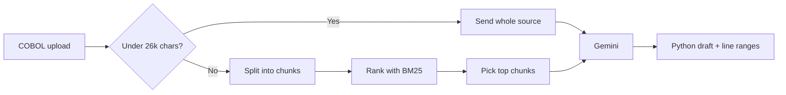

# legacy-agent ⚡

> Turn legacy COBOL into readable Python with Gemini and local BM25 retrieval.

[](#quickstart)
[](#how-it-works)
[](#license)

Ten days of Dallas hospice care should cost **$1,911**. One typo made Medicare's code pay **$134,248**, with no error.

Code like this still runs banks and government programs, and very few people can safely change it. legacy-agent helps you read it and move it to Python.

---

## Features

- **Upload COBOL** (`.cbl`, `.cob`, `.cpy`, or a `.zip`) and get a Python draft.
- **Handles large programs** by sending Gemini only the most relevant code.
- **Shows its work** by listing the exact line ranges the model saw.
- **Built-in demo** using the real CMS Medicare hospice pricer.

> [!IMPORTANT]
> Output is a draft. It isn't run or tested automatically, so review it before use.

---

## Quickstart

Requires Node.js 20+ and a [Gemini API key](https://aistudio.google.com/apikey).

```bash
git clone https://github.com/AKdaAKA/legacy-agent.git
cd legacy-agent
npm install
cp .env.example .env   # then set GEMINI_API_KEY
npm run dev
```

Open http://localhost:5173.

For production, run `npm start` and open http://localhost:3001.

| Variable | Default | Purpose |
|---|---|---|
| `GEMINI_API_KEY` | required | Server-side key, never sent to the browser |
| `GEMINI_MODEL` | `gemini-2.5-flash` | Model used for conversion |
| `PORT` | `3001` | API and production server port |

---

## How it works



### Why BM25?

Large COBOL programs are too big to send to an AI all at once. BM25 is a keyword search that ranks each chunk of code by how relevant it is.

- **COBOL is keyword-heavy.** Words like `COMPUTE`, `EVALUATE`, and `PIC` mark where the real logic is.
- **Exact names matter.** BM25 matches identifiers like `HR-BILL-PAY-AMT1` exactly.
- **It runs locally.** No embeddings API, no vector database, no extra cost.

The retriever is built on LangChain's `BaseRetriever`, so each chunk keeps its file name and line numbers. It always includes each file's first chunk and small copybooks, then fills a 26,000-character budget with the top-ranked chunks.

---

## Case study: Medicare hospice pricer

[`legacy_data/hospice-legacy`](legacy_data/hospice-legacy/README.md) contains the real COBOL Medicare used to price hospice claims in 2020, from the [CMS Pricer archive](https://www.cms.gov/pc-pricerarchive). You can compile and run it with GnuCOBOL.

```bash
brew install gnucobol
./legacy_data/hospice-legacy/build.sh
python3 legacy_data/hospice-legacy/price.py --cbsa 19124 --admit 2020-02-01 --from 2020-03-01 --rhc 10
```

`price.py` runs claims through the original compiled COBOL. The example above returns **$1,911.19**.

**What we found:**
- A wage value typed as `99.9999` makes the code pay **$134,248.47** and report success.
- The COBOL truncates the hourly crisis-care rate to 4 decimals mid-calculation. A rewrite that skips this is off by one cent.

---

## Project structure

```text
server/index.mjs        Node API: BM25 retrieval and Gemini calls
src/                    React frontend
legacy_data/            CMS hospice pricer case study
```

---

## Limitations

- Retrieval can leave out code. Check the listed line ranges.
- Uploaded code is sent to Google's Gemini API.
- Only the hospice case study was compared against the original COBOL.

---

## License

MIT
